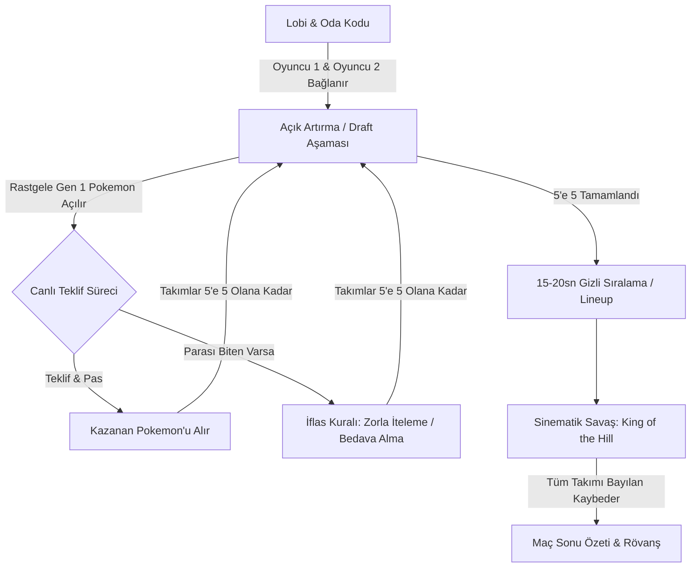

# ⚡ PokéAuction: Blind Draft & Auto-Battler — Mimari ve Tasarım Dokümanı

> **Konsept:** Viral "Kör Takım Kurma" trendi ile klasik Pokedex / Pokemon Gen 1 evrenini birleştiren, gerçek zamanlı 1v1 açık artırma ve sinematik otomatik savaş oyunu.

---

## 🎯 1. Oyun Döngüsü (Core Game Loop)



---

## ⚔️ 2. Kurallar ve Mekanikler

### A. Açık Artırma (Draft) Aşaması
1. **Başlangıç Bütçesi:** Her iki oyuncuya **100 Pokédolar / Altın**.
2. **Kadro Kotası:** Her takım tam **5 Pokemon** toplayacak.
3. **Canlı Ticking Açık Artırma (eBay/Poker Tarzı):**
   - Hakem (Sistem) rastgele bir Gen 1 Pokemon ortaya atar.
   - 6 saniyelik bir geri sayım başlar.
   - Bir oyuncu teklif verdiğinde (+1, +2, +5 veya özel miktar), sayaç anında 3-4 saniyeye resetlenir.
   - Diğer oyuncu "Pas" derse veya süre dolarsa, son teklifi veren oyuncu Pokemon'u kadrosuna katar.
4. **İflas & İteleme Kuralı (Bütçesi Biten Oyuncu):**
   - Parası **0** olan oyuncu artık açık artırmaya katılamaz ve teklif veremez.
   - Yeni bir Pokemon açıldığında, parası olan oyuncunun önünde 2 seçenek vardır:
     - **Bedavaya Al:** Parası olan oyuncu bu Pokemon'u doğrudan kendi takımına katabilir.
     - **Rakibe İtele:** Parası olan oyuncu Pokemon'u istemezse, parası biten oyuncu o Pokemon'u **zorunlu olarak** takımına almak zorundadır (Magikarp, Caterpie, Zubat gibi zayıf Pokemon'ları rakibe doldurma stratejisi!).
   - İki oyuncu da 5 Pokemon'a ulaşana kadar tur devam eder.

### B. Taktiksel Hazırlık (Lineup) Aşaması
- Draft tamamlandıktan sonra oyunculara **15-20 saniyelik gizli hazırlık süresi** verilir.
- Oyuncular ellerindeki 5 Pokemon'u sahaya çıkış sırasına göre dizer:
  - **1. Slot:** Öncü (Lead)
  - **2., 3., 4. Slotlar:** Orta saha
  - **5. Slot:** Son Kale (Anchor)
- Rakip, savaş başlayana kadar senin sıralamanı göremez.

### C. Sinematik Savaş Simülasyonu: "King of the Hill" (Meydan Savaşı)
- **1v1 Karşılaşma:** İki tarafın da 1. sıradaki Pokemon'ları sahaya iner.
- **Hız (Speed) & Sıra:** Hızı yüksek olan Pokemon önce saldırır.
- **Hasar Formülü & Tip Üstünlüğü:**
  - Saldıranın Attack / Sp. Attack değeri vs. Savunanın Defense / Sp. Defense değeri.
  - Tip Matrisi: Klasik Pokemon kuralları geçerlidir (Su > Ateş [x2], Çim > Su [x2], Elektrik > Yer [x0] vb.).
  - Kritik Vuruş (Critical Hit): %10 şansla x1.5 hasar ve ekran sarsıntısı.
- **Meydan Savaşı Kuralı:**
  - Bir Pokemon bayıldığında (HP = 0), sahada kalan galip Pokemon **mevcut kalan canıyla** savaşmaya devam eder!
  - Yenilen oyuncu sıradaki Pokemon'unu sahaya sürer.
  - 5 Pokemon'u da bayılan oyuncu maçı kaybeder.

---

## 🎨 3. Görsel & İşitsel Atmosfer (Prodüksiyon Kalitesi)

* **Görseller:**
  * Pokemon Showdown hareketli GIF sprite'ları (Ön ve Arka açılı animasyonlar).
  * Darbe efektleri (Slash, Fire blast, Water pulse, Thunderbolt partikül CSS animasyonları).
  * Ekran sarsıntısı (Screen Shake) ve dinamik renk değiştiren can barları (Yeşil -> Sarı -> Kırmızı).
* **Sesler (SFX & Audio):**
  * Açık artırma geri sayım tik-tak sesi ve tokmak vuruşu.
  * Pokemon çığlıkları (Gen 1 retro cry sesleri).
  * Saldırı, vuruş, süper etkili (Super Effective) ve bayılma (Faint) sesleri.
  * İsteğe göre tek tıkla ses kapatma (Mute) düğmesi.

---

## 🏗️ 4. Teknik Mimari (Birleşik Monorepo)

```
pokemon-blind-draft/
├── backend/
│   ├── src/
│   │   ├── data/
│   │   │   ├── pokemon_gen1.json     # 151 Pokemon statları, tipleri, saldırıları
│   │   │   └── type_chart.json       # Tip etkinlik matrisi (x2, x0.5, x0)
│   │   ├── game/
│   │   │   ├── RoomManager.js        # Oda kodları ve oyuncu eşleşmeleri
│   │   │   ├── AuctionEngine.js      # Canlı teklif, süre resetleme ve iflas mantığı
│   │   │   └── BattleEngine.js       # Adım adım simülasyon hesaplayıcı (Turn timeline)
│   │   └── server.js                 # Express + Socket.io sunucusu
├── frontend/
│   ├── src/
│   │   ├── components/
│   │   │   ├── Lobby/                # İsim girme, oda oluşturma / katılma
│   │   │   ├── Auction/              # Canlı borsa arayüzü, Pokemon kartı, teklif butonları
│   │   │   ├── Lineup/               # Sürükle-bırak / tıkla sırala hazırlık ekranı
│   │   │   ├── BattleArena/          # 2D Stadyum, hareketli sprite'lar, can barları
│   │   │   └── MatchSummary/         # MVP Pokemon, verilen hasarlar, rövanş butonu
│   │   ├── hooks/useSocket.js        # Canlı soket dinleyicileri
│   │   ├── assets/sounds/            # SFX ses dosyaları
│   │   └── App.jsx
│   └── index.html
└── package.json                      # Tek komutla hem backend hem frontend çalıştırma
```

---

## 🚀 5. Geliştirme Yol Haritası (Roadmap)

1. **Adım 1: Veri & Çekirdek Motorların Kurulumu**
   - Gen 1 Pokemon veri tabanı (Statlar, Tipler, Sprite URL'leri, İmza Hareketler).
   - Sunucu tarafında deterministik `BattleEngine` (Savaş adım adım hesaplanır, ön yüze timeline olarak iletilir).
2. **Adım 2: Socket.io Lobi ve Açık Artırma Motoru**
   - 4 haneli oda kodları ile 1v1 eşleşme.
   - Canlı teklif sayacı, pas mekaniği, iflas/rakibe iteleme kuralı.
3. **Adım 3: Sıralama (Lineup) ve Sinematik Savaş Arayüzü**
   - Showdown animasyonlu sprite'ları, can barı animasyonları, sıra sıra aksiyon gösterimi.
4. **Adım 4: Ses Efektleri, Ses Açma/Kapama ve Cila**
   - Tokmak sesi, vuruş efektleri, ekran titremesi, MVP paneli ve Rövanş akışı.
5. **Adım 5: Dağıtım Hazırlığı (VPS / Docker)**
   - Tek komutla (`npm start` veya `docker compose up`) canlıya alma konfigürasyonu.
